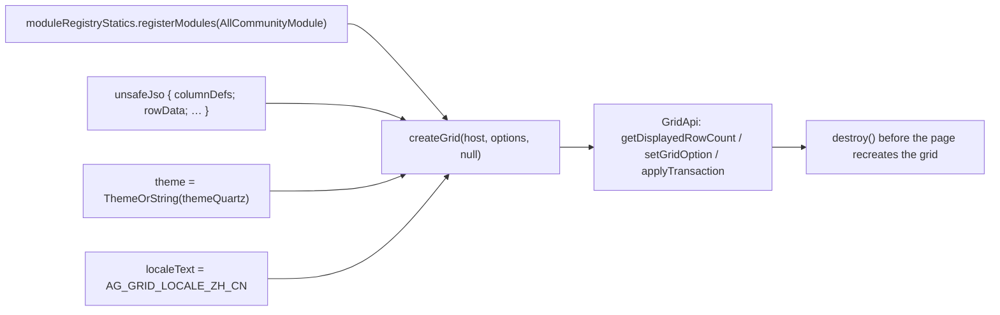

# Using the wrapper

The module publishes as `io.github.shijianjs:ktjs-aggrid:36.3.0-kt.1` (the upstream version plus the
wrapper revision). Adding it to a Kotlin/JS module is one line; the npm packages it wraps come with it,
because the wrapper declares them as Kotlin/JS npm dependencies:

```kotlin
kotlin {
    js {
        browser()
        binaries.executable()
    }
    sourceSets {
        jsMain.dependencies {
            implementation("org.jetbrains.kotlin-wrappers:kotlin-browser:2026.11.1")
            implementation("io.github.shijianjs:ktjs-aggrid:36.3.0-kt.1")
        }
    }
}
```

Every declaration lives in one Kotlin package, `io.github.shijianjs.ktjs.aggrid`, with the same names
AG Grid uses — there is nothing to look up beyond the upstream docs.

## Register the modules, then create the grid

AG Grid 33+ is module-based: nothing works until the community module is registered. That call is a
static member of the upstream `ModuleRegistry` class, which the wrapper exposes as
`moduleRegistryStatics`:

```kotlin
import io.github.shijianjs.ktjs.aggrid.AllCommunityModule
import io.github.shijianjs.ktjs.aggrid.Module
import io.github.shijianjs.ktjs.aggrid.createGrid
import io.github.shijianjs.ktjs.aggrid.moduleRegistryStatics

moduleRegistryStatics.registerModules(arrayOf<Module>(AllCommunityModule))

val api = createGrid(hostElement, gridOptions(), null)
```

`AllCommunityModule` bundles every community feature; registering individual feature modules
(`ClientSideRowModelModule`, `CsvExportModule`, …) is the same call with a different array and is how you
keep a bundle small. The `Array<Module>` type argument is explicit on purpose — Kotlin arrays are not
covariant, and the modules are declared as their narrower upstream types.



## Options are plain objects

`GridOptions` and `ColDef` are `external interface`s, so they are built with `unsafeJso` — no builders,
no `js("({})")`, and every property is type-checked:

```kotlin
val options = unsafeJso<GridOptions> {
    columnDefs = arrayOf<JsAny>(
        unsafeJso<ColDef> {
            field = "make"
            headerName = "Make"
            sortable = true
            filter = true
        },
        unsafeJso<ColDef> {
            field = "price"
            headerName = "Price"
            sortable = true
        },
    )
    rowData = arrayOf<JsAny>(row("Toyota", 32000.0), row("Ford", 35000.0))
    defaultColDef = unsafeJso<ColDef> { flex = 1.0 }
    pagination = true
    paginationPageSize = 5.0
}
```

Note what is *not* written: `columnDefs` takes `Array<JsAny>` rather than a `ColDef | ColGroupDef` union,
because upstream declares it as a generic union of two structural types (see
[API coverage](api-coverage.md#what-the-wrapper-cannot-express)). Each element is still a checked
`ColDef`; only the array's element type is wide.

Optional properties are `T?`: leave a property unset and the grid sees `undefined`. Assigning `null`
writes a real `null`, which is a different thing to AG Grid.

## Call the GridApi

`createGrid` returns the `GridApi`, and the wrapper gives you the upstream method surface — including the
members AG Grid declares on its internal base interfaces, such as `destroy()`:

```kotlin
val api = createGrid(host, options, null)

api.getDisplayedRowCount()            // Double
api.getColumnDefs()                   // Array<JsAny>?
api.getGridOption("rowData".unsafeCast<JsAny>())
api.setGridOption("rowData".unsafeCast<JsAny>(), newRows)

api.applyTransaction(unsafeJso<RowDataTransaction> {
    add = arrayOf<JsAny>(row("Nissan", 25000.0))
})

api.destroy()
```

`destroy()` matters: outside a framework AG Grid has no lifecycle hook of its own, and a page that
recreates the grid (a language switch, for instance) leaks the previous instance without it.

## Literals and locale text

Upstream string unions are `sealed external interface`s with a constant object next to them, so a typo is
a compile error rather than a mysterious runtime default:

```kotlin
import io.github.shijianjs.ktjs.aggrid.LabelAlignments

labelAlignment = LabelAlignments.left       // upstream: 'left' | 'right' | 'top'
```

The locale packages arrive as plain data. `AG_GRID_LOCALE_EN_US` and `AG_GRID_LOCALE_ZH_CN` are
`LocaleStrings` values; the `localeText` option is declared as `Partial<LocaleStrings>`, which the
emitter leaves as an empty interface, so hand the table over as is:

```kotlin
import io.github.shijianjs.ktjs.aggrid.AG_GRID_LOCALE_ZH_CN

localeText = AG_GRID_LOCALE_ZH_CN.unsafeCast<LocaleText>()
```

That localises everything AG Grid prints itself — paging labels, filter menus, the "no rows" overlay,
sort tooltips.

## Theming

The Theming API is a grid option, not a stylesheet. The wrapper exports the stock themes and the
colour-scheme parts, and `Theme.withPart(...)` returns a new theme:

```kotlin
import io.github.shijianjs.ktjs.aggrid.ThemeOrString
import io.github.shijianjs.ktjs.aggrid.colorSchemeDark
import io.github.shijianjs.ktjs.aggrid.themeQuartz

theme = ThemeOrString(themeQuartz)
// or, dark:
theme = ThemeOrString(themeQuartz.withPart(colorSchemeDark))
```

`theme` is also how you keep a CSS-file theme working: `ThemeOrString("legacy")` plus `ag-grid.css` in
the page. Mixing the two without saying so is what AG Grid reports as error #239.

## Where the wrapper stops

- **No generic parameters.** AG Grid is thoroughly generic in `TData` / `TValue`; the wrapper drops the
  parameters (upstream `ColDef<TData, TValue>` is `ColDef`). Callbacks therefore take `JsAny` where
  upstream would have had the row type.
- **`any` / `unknown` stay `JsAny`.** That is the upstream truth, not a shortcut.
- **Objects come from `unsafeJso`,** never from a wrapper-specific builder; there is no DSL to learn.

The full picture, including the 402 places where the emitted type is wider than upstream's, is in
[API coverage](api-coverage.md).
