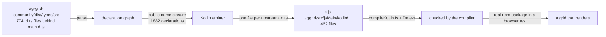

# Introduction

`ktjs-aggrid` is a Kotlin/JS wrapper around [AG Grid Community](https://www.ag-grid.com/), the
open-source half of AG Grid: `ag-grid-community` 36.3.0 plus `@ag-grid-community/locale` 36.3.0. The
Enterprise packages are commercially licensed and are deliberately out of scope, so every declaration
here describes something you can ship under AG Grid's MIT licence.

AG Grid is a large package — 774 `.d.ts` files exported through one `main.d.ts`. Hand-writing that
surface would be a transcription exercise with no way to keep it honest, so the declarations are
**generated** from the published type definitions and then compiled:

The result is checked by the compiler, not by hand: `./gradlew :ktjs-aggrid:compileKotlinJs` fails if a
declaration disagrees with the generated imports, Detekt checks the emitted code, and the browser tests
load the real `ag-grid-community` package and create a grid.

## What is in the repository

| Part | Role |
| --- | --- |
| `ktjs-aggrid` | the wrapper: the generated `external` declarations for `ag-grid-community` and its locale package |
| `scripts/generate-api.py` | the parser and public-surface closure: which upstream declarations are reachable from `main.d.ts` |
| `scripts/ktjs_emitter.py` | the Kotlin emitter: types, unions, literals, statics, imports |
| `scripts/regenerate.ps1` | one command that re-runs both against the installed npm packages |
| `demo` | a page that creates a grid, pages and filters it, adds rows and switches language — published under `/demo/` |
| `docs` | this site, built by the [ktjs-docusaurus](https://github.com/shijianjs/ktjs-docusaurus) Gradle plugin |

The API reference under `/api/` is Dokka output for the published module, assembled by `pagesSite`
next to this site and the demo.

## Scope, in one table

| Included | Excluded |
| --- | --- |
| `ag-grid-community` (MIT) | `ag-grid-enterprise`, `ag-grid-charts`, `@ag-grid-enterprise/*` (commercial) |
| `@ag-grid-community/locale` (MIT) | AG Charts types that AG Grid only references (`AgChart*`, `AgSparklineOptions`) |
| the `ag-stack` types AG Grid re-exports | runtime behaviour: this wrapper ships no JavaScript of its own |

## Where to go next

- [Getting started](guide/getting-started.md) — build it, test it, run the two dev servers.
- [Using the wrapper](guide/using-the-wrapper.md) — registration, grid creation, options, transactions,
  locale and theming.
- [API coverage](guide/api-coverage.md) — how the declarations are produced, what the 402 fallbacks are,
  and what the wrapper cannot express.
