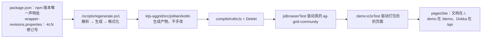

# 快速开始

## 环境要求

- JDK 21 或更新；Gradle wrapper 已随仓库提供（9.4.1）。
- Node 与 npm 由 Kotlin Gradle 插件下载和驱动——没有需要记的 `npm install` 步骤，
  `kotlin.js.yarn=false` 保证包管理器是 npm。
- 第一次跑浏览器测试时，Playwright 会下载 Chromium。

## 构建、测试、发布

```bash
./gradlew build                         # 编译 + Detekt + 浏览器测试
./gradlew :ktjs-aggrid:jsBrowserTest    # 只跑封装模块的浏览器测试
./gradlew :demo:e2eTest                 # 用 Playwright 跑打包后的示例页
./gradlew :docs:docusaurusBuild         # 本站
./gradlew pagesSite                     # 文档在 /，示例在 /demo/，Dokka 在 /api/
```

`build` 不会跑示例的端到端测试，也不会组装 Pages 站点：两者都需要浏览器，在 CI 中是单独的步骤。

## 开发

```bash
./gradlew :docs:docusaurusStart          # 本站的开发服务器
./gradlew :demo:jsBrowserDevelopmentRun  # 示例页的开发服务器
```

Docusaurus 会监听站点目录，改 Markdown 会热更新；改 Kotlin 需要先
`./gradlew :docs:docusaurusSite`，因为站点 import 的是编译产物。

## 各目录的职责

| 路径 | 内容 |
| --- | --- |
| `package.json` | 唯一声明 npm 版本的地方（Dependabot 维护） |
| `wrapper-revisions.properties` | 每个模块的 `-kt.N` 修订号 |
| `ktjs-aggrid/src/jsMain/kotlin` | 生成的声明——不要手改 |
| `ktjs-aggrid/src/jsTest/kotlin` | 驱动真实包的浏览器测试 |
| `scripts/` | 生成器（`generate-api.py` + `ktjs_emitter.py`）与 `regenerate.ps1` |
| `demo/src/jsMain` | 示例页与它的 Kotlin 入口 |
| `docs/src/jsMain/kotlin` | 站点配置与侧边栏 |
| `docs/src/jsMain/resources` | Markdown 页面、MDX 首页、CSS、翻译 |
| `docs/development/` | 生成的 [API 面报告](https://github.com/shijianjs/ktjs-aggrid/blob/main/docs/development/api-surface-report.md) |



## lock 文件

整个工作区的 npm 依赖只解析一次，固定在 `kotlin-js-store/package-lock.json`。新增或升级 npm 依赖、
或者改动模块版本之后，都要重新生成：

```bash
./gradlew kotlinUpgradePackageLock
```

CI 会校验提交的 lock 文件，忘记重新生成会让构建失败，而不是慢慢漂移。

## 重新生成声明

发射器读取的 TypeScript 文件就是 npm 装下来的那份，不需要另外下载：

```bash
./gradlew :ktjs-aggrid:kotlinNpmInstall   # build/js/node_modules/ag-grid-community/…
./gradlew :ktjs-aggrid:kotlinUpgradePackageLock
./scripts/regenerate.ps1                  # 解析 → 发射 → 格式化，并重写 API 面报告
./gradlew :ktjs-aggrid:compileKotlinJs    # 真正证明产物自洽的一步
```

先改 `package.json` 里的版本，再重新生成并编译。细节见 [API 覆盖](api-coverage.md)。
